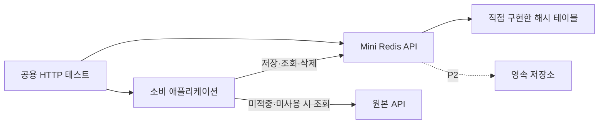

# Mini Redis 공통 PRD

버전: 4.2 · 상태: 최종 공통 기준 · 작성일: 2026-11-12

팀원은 각자의 언어·프레임워크·내부 구조로 구현한다. 외부 HTTP/JSON API와 검증 시나리오는 공통으로 맞춘다. 최소 지원 범위·데모·실험 기본값은 과제 원문을 구현·비교 가능한 수준으로 구체화한 팀 기준이며, 원문에 추가 명령이나 성능 하한이 있는 것으로 해석하지 않는다.

## 1. 개요·범위·완료 기준

해시 테이블(Hash Table) 기반 키-값(Key-Value) 저장소를 직접 만들고 외부 API로 제공한다. 간단한 원본 API의 응답을 캐싱해 실제 사용과 성능 차이를 검증한다. AI를 적극 활용해 결과물을 만들되 핵심 로직과 설계 판단을 설명할 수 있어야 한다.

| 우선순위 | 범위 |
|---|---|
| P0 필수 | 해시 테이블 직접 구현, 저장·조회·삭제 API, TTL, 키별 무효화, 동시성 안전성, 단위·기능·동시성 테스트, 캐싱 데모·성능 비교, 실행·설계 설명 |
| P1 권장 | 미조회 만료 데이터 자동 회수, CI, 캐시 장애 시 원본 우회, 추가 성능·자원 측정 |
| P2 선택 | 서버 장애 시 데이터 보존·복구(명세의 Optional) |

EXPIRE·TTL 조회·PERSIST·INCR 등 추가 명령, Redis 프로토콜 호환, 클러스터·복제, 복합 자료형, 자동 축출(Eviction), 인터넷 공개 운영은 필수 범위에서 제외한다. TTL은 저장 요청의 선택 필드로 제공한다.

**완료 기준:** 공통 API와 AC1~6을 충족하고 6장의 필수 검증을 통과하며 7장의 자료를 공유한다. 선택 기능은 구현한 경우에만 해당 검증을 적용한다. P1·P2 미구현은 P0 완료를 막지 않는다.

**진행 순서:** 개인 스택·설계 확정 → 해시 테이블·API·데모 구현 → 검증 → 설명·보완. 제출일은 팀에서 합의한다. AI에는 이 PRD와 개인 설계 선택을 함께 전달하고 단계별 테스트 통과 후 다음 단계로 진행한다. 공통 계약 변경은 이유와 영향을 공유한다.

## 2. 시스템 구성과 공통 캐싱 데모

포트는 설정 가능하게 하고 공용 스크립트에 세 서비스의 기준 URL(Base URL)을 전달한다. 각 서비스는 자기 초기화 완료 후 `GET /health`에 200 `{"status":"ok"}`를 반환한다. P2 복구도 준비 완료 전에 끝낸다. 스크립트는 제한 시간 내 준비 응답을 기다리고 실행한다. 내부 모듈 구성은 자유지만 코어를 HTTP 없이 단위 테스트할 수 있어야 한다.

### 공통 데이터 계약

| 항목 | 공통 동작·최소 지원 | 개인 선택 |
|---|---|---|
| 키(Key) | 대소문자 구분. 영문·숫자·콜론·밑줄·하이픈 조합으로 1~256바이트 지원. 빈 키 거부 | 추가 문자·더 큰 상한·내부 표현 |
| 값(Value) | UTF-8 문자열, 빈 문자열 포함 65,536바이트(64 KiB)까지 지원. 원문 보존 | 더 큰 상한·내부 표현 |
| TTL | `ttl_ms` 양의 정수 밀리초. 1~2,592,000,000ms(30일) 지원. 생략 시 무기한 | 최대 지원값·시간원 |
| 덮어쓰기 | 값·TTL을 함께 교체. TTL 생략 시 기존 TTL 제거 | 저장 구조 |

크기는 JSON 디코딩 후 UTF-8 바이트 기준이다. 키·값·요청 크기·TTL의 실제 상한과 고정 용량의 수용 키 수를 실행 문서에 기록한다. 요청 크기 상한 때문에 최소 지원 범위의 정상 값이 거부되지 않게 한다. 공용 정상 테스트는 최소 지원 범위 안에서 실행하고 추가 상한 경계는 개인 테스트로 확인한다.

### 데모 인터페이스와 동작

팀은 같은 원본 서비스 또는 같은 설정의 사본을 사용한다. 테스트별로 상품·캐시·카운터·실패 모드를 분리하거나 초기화하고 다른 실행과 간섭하지 않게 한다.

| 대상 | 인터페이스 | 동작 |
|---|---|---|
| 원본 | `GET /products/{id}` | 200 상품 JSON. 예: `{"id":"42","name":"sample","version":1}`. 없는 상품은 404. 응답 지연 설정 가능, 기본 100ms |
| 원본 | `PUT /products/{id}` | `{"name":"sample","version":2}`로 생성·변경. 200과 변경 상품 반환. id는 경로의 실제 식별자 |
| 원본·테스트용 | `GET /test/counters`, `DELETE /test/counters` | 각각 200 `{"get_calls":3}` 조회, 200 `{"ok":true}` 초기화. 상품 GET만 성공·실패 모두 집계 |
| 원본·테스트용 | `PUT /test/fail` | `{"enabled":true}`이면 상품 GET에 500 반환, false면 복구. 설정 성공은 200 `{"ok":true}` |
| 소비 앱 | `GET /demo/products/{id}?cache=on` (off 지원) | off는 항상 원본 조회, on은 캐시 우선. 생략은 on, 다른 값은 400. 성공 시 200과 원본 상품 JSON |
| 소비 앱 | `PUT /demo/products/{id}` | 같은 본문으로 원본 변경 후 `product:{id}` 삭제. 둘 다 성공하면 200과 변경 상품 반환 |

소비 앱은 `product:{id}`를 조회하고 미적중이면 원본 성공 응답을 문자열로 저장한 뒤 반환한다(Cache-Aside). 조회 성공 응답의 `X-Cache`는 HIT(캐시 반환)·MISS(미적중 후 원본 조회)·BYPASS(cache=off)로 구분한다. 헤더와 원본 호출 횟수를 함께 확인한다. 원본 데이터는 PUT 전까지 동일하게 유지한다.

TTL은 설정값 `cache_ttl_ms`로 제공한다. 데모 기본값은 60,000ms, 기능 테스트 기본값은 1,000ms다. 원본 404는 소비 앱도 404로 반환하고 부재는 캐싱하지 않는다(Negative Caching 없음). 원본 5xx·시간 초과 또는 캐시 조회·저장·삭제 실패는 502다. 캐시 GET의 정상 404는 실패가 아닌 미적중이다. 실패 응답은 캐싱하지 않는다. 원본 변경 실패 시 캐시 삭제 단계로 진행하지 않는다.

캐시와 원본을 묶은 트랜잭션은 없다. 원본 변경 후 캐시 삭제가 실패하면 이미 원본은 바뀌었을 수 있다. 캐시 장애 시 원본 우회는 P1 확장이며 기본 검증에서는 비활성화한다.

## 3. API 명세와 인수 조건

### 공통 HTTP/JSON 계약

| 연산·요청 | 입력 | 성공 응답·규칙 |
|---|---|---|
| SET · `PUT /keys/{key}` | `{"value":"A","ttl_ms":60000}`. value 필수, ttl_ms 선택 | 200 `{"ok":true}`. 생성·갱신 모두 지원, 값·TTL 원자적 교체 |
| GET · `GET /keys/{key}` | 경로 key | 200 `{"key":"sample","value":"A"}`. key는 요청 키 원문, 조회로 TTL 연장 없음 |
| DELETE · `DELETE /keys/{key}` | 경로 key | 200 `{"deleted":1}` 또는 `{"deleted":0}`. 유효 키 삭제 시 1, 없거나 만료면 0 |

PUT 본문과 정상 응답은 `application/json`을 사용한다. 키는 URL 인코딩 후 경로에 전달하고 디코딩한 키로 판단한다. `/keys/`의 빈 키, value 누락·null·문자열 외 타입, TTL 0·음수·비정수·문자열·null·지원 범위 초과는 400이다. 알 수 없는 추가 필드의 무시·거부는 개인 선택이며 공용 테스트 판정에서 제외한다.

저장소 오류는 `{"error":{"code":"INVALID_ARGUMENT","message":"설명"}}` 형식이다. message 문구는 자유다.

| HTTP · code | 조건 |
|---|---|
| 400 · INVALID_ARGUMENT | 잘못된 키·JSON·필수 필드·타입·TTL |
| 404 · KEY_NOT_FOUND | GET의 없는 키·만료 키 |
| 413 · LIMIT_EXCEEDED | 선언한 키·값·요청 크기 상한 초과 |
| 503 · CAPACITY_EXCEEDED | 선언한 저장 용량 부족 |
| 500 · INTERNAL_ERROR | 예기치 않은 내부 실패 |

정의되지 않은 경로는 404, 알려진 경로의 미지원 메서드는 405, PUT의 부적합 Content-Type은 415로 판정하되 본문은 프레임워크 기본값을 허용한다. `application/json; charset=utf-8`은 허용한다. 입력 오류·상한 초과·용량 부족은 기존 값·TTL을 변경하지 않는다. 만료된 키는 부재이므로 GET은 404, DELETE는 0, SET은 새 값으로 저장한다. 공용 테스트는 중간 HTTP 캐시나 클라이언트 응답 캐시를 사용하지 않는다.

### 인수 조건(Acceptance Criteria)

| ID | 사전 조건(Given) | 동작(When) | 기대 결과(Then) |
|---|---|---|---|
| AC1 | 키 없음 | A 저장 후 조회 | 저장 200, A 반환 |
| AC2 | A와 TTL 있음 | TTL 없이 B 저장 | B 반환, 기존 TTL 제거, 중복 키 없음 |
| AC3 | 키 없음 | 빈 문자열 저장·조회 | 빈 문자열 반환, 부재와 구분 |
| AC4 | 유효 키 있음 | 삭제·조회·재삭제 | 각각 deleted=1·404·deleted=0 |
| AC5 | TTL로 저장 | 만료 전·후 조회 | 각각 값·404, 조회로 TTL 연장 없음 |
| AC6 | 기존 값·TTL 있음 | 잘못된 필드·타입·TTL로 저장 | 400, 기존 값·TTL 유지 |

## 4. 핵심 설계 결정

키 탐색·충돌 처리·삽입·갱신·삭제는 직접 구현한다. 배열·리스트·언어의 해시 함수는 활용할 수 있으나 내장 맵·실제 Redis로 핵심 저장소를 대체하지 않는다. 충돌 키 탐색·해시 주입·용량 제어 등으로 테스트에서 실제 충돌을 재현할 수 있게 한다. 초기 용량 설정만으로 충돌이 발생했다고 가정하지 않는다.

각자는 아래 표의 마지막 열에 **선택·이유·보장 범위·한계**를 기록한다. 권장안은 출발점이며 다른 선택도 허용한다.

| 결정 | 선택지 | 권장안·근거 | 내 선택·이유 |
|---|---|---|---|
| 해시 함수(Hash Function) | 제공 함수 / 직접 구현 | 원리·분포·비용을 설명하고 충돌을 검증할 수 있는 함수 | 구현자가 기록 |
| 충돌 처리(Collision Resolution) | 체이닝(Chaining) / 개방 주소법(Open Addressing) | 체이닝: 삭제 경로가 단순하고 충돌을 관찰하기 쉬움 | 구현자가 기록 |
| 용량·재해싱(Rehashing) | 고정 용량 / 일괄 확장 / 점진적 확장 | 일괄 확장: 값·TTL 보존 검증이 쉬움. 확장 중 정지 시간은 한계 | 구현자가 기록 |
| 동시성(Concurrency) | 직렬 실행 / 전역 락 / 읽기·쓰기 락 / 분할 처리 | 전역 락 또는 중단 없는 직렬 실행: 연산 순서를 설명하기 쉬움 | 구현자가 기록 |
| 만료(Expiration) | 지연 만료 / 주기 정리 / 타이머·혼합 | 지연 만료로 P0 정확성 확보, 미조회 데이터 회수는 P1로 추가 | 구현자가 기록 |
| 무효화(Invalidation) | TTL만 / 키별 삭제 / 버전 기반 | 키별 삭제: 사용자 제어가 명확. TTL은 보완 수단 | 구현자가 기록 |

- **동시성:** 단일 키 연산은 실제 비중첩 순서를 지키는 순차 실행으로 설명 가능해야 한다(선형화 가능성, Linearizability). 값·TTL 부분 갱신, 손상·교착 상태(Deadlock)가 없어야 한다.
- **만료:** 현재 시각이 만료 시각 이상이면 부재다. 물리 정리가 늦어도 만료 값을 반환하지 않고 과거 만료 작업으로 새 값을 삭제하지 않는다. 단조 시계(Monotonic Clock)를 권장하며 선택한 시간원·정밀도를 설명한다.
- **무효화:** 삭제 완료 후 시작한 조회는 중간에 새 저장이 없다면 부재다. 원본 조회 도중 무효화 후 예전 값 재저장 등의 한계는 설명하되 해결은 필수가 아니다. TTL만으로 사용자 무효화를 대체하지 않는다.
- **용량:** 고정 용량은 부족 시 명시적으로 거부하고 기존 데이터를 보존한다. 확장은 값·TTL·키 수를 보존한다. 같은 키 갱신이 중복 키를 만들면 안 된다.

주요 함수의 동작 순서와 평균·최악 시간 복잡도(Time Complexity)를 코드·테스트와 연결해 설명한다. AI가 작성한 코드도 같은 기준이다.

## 5. 영속성(Persistence) — P2

구현하는 팀원만 작성한다. 실제 Redis 파일 형식 호환은 요구하지 않는다.

| 방식 | 비교할 내용 | 내 선택·이유 |
|---|---|---|
| 스냅샷(Snapshot, RDB 방식) | 시점 상태 저장·복구의 단순성, 마지막 완료 저장 이후 손실, 일관된 파일 교체 | 선택 구현자가 기록 |
| 추가 전용 로그(AOF) | 동기화 정책에 따른 보존, 기록·재생·로그 증가 비용, 부분 기록 처리 | 선택 구현자가 기록 |

선택 이유, 대상 장애, 복구 지점·허용 손실, 성공 응답과 디스크 반영 순서, 저장·복구 실패 시 응답·서비스 상태를 정한다. 재시작 중 경과한 시간을 반영할 수 있도록 절대 만료 시각 또는 동등한 시간 정보를 기록한다. 런타임의 단조 시각 값을 그대로 저장해 재사용하지 않는다.

| ID | 검증 케이스 | 기대 결과 |
|---|---|---|
| PT1 | 저장·덮어쓰기·삭제를 약속한 복구 지점까지 반영한 뒤 대상 장애·재시작 | 약속한 최신 값 복원, 보존된 삭제는 재등장하지 않음 |
| PT2 | 미만료 키와 중단 중 만료되는 키 저장 후 재시작 | 전자는 남은 수명만 유지, 후자는 부재. TTL 처음부터 재시작 없음 |
| PT3 | 쓰기·동기화 등 선택한 저장 경로의 실패 주입 | 선언한 실패 응답·후속 상태 준수, 보존 실패를 성공 보장으로 표시하지 않음 |
| PT4 | 로그 끝부분 절단 또는 스냅샷 저장·교체 중 중단 등 방식별 불완전 파일 재현 | 유효 로그·이전 완료 스냅샷 복구 또는 명시적 기동 거부. 손상 데이터를 정상으로 취급하지 않음 |

주기 동기화 설정만으로 엄밀한 손실 시간 상한을 단정하지 않는다. 프로세스 강제 종료 실험을 전원·저장 장치 장애의 검증으로 표현하지 않는다.

## 6. 검증 계획

단위·내부 경합 검증은 개인 스택으로, 외부 기능·동시 부하·성능은 공용 HTTP 스크립트로 실행한다. URL·데모 TTL·필요한 용량 설정을 전달한다. 테스트 초기 상태를 분리하고 한 행의 여러 입력·전이는 독립적인 하위 테스트로 실행한다. ID·실행 조건·기대/실제 결과·통과 여부를 남긴다.

엣지 케이스(Edge Case)는 아래 목록에 통합했다. 확장·자동 회수 등 선택한 기능의 조건부 케이스만 미적용 처리할 수 있으며 이유를 기록한다. 실제 시간의 미세한 sleep 차이로 만료 경계를 판정하지 않는다.

### T1. 단위 테스트

| ID | 케이스 | 판정 기준 |
|---|---|---|
| U1 | AC1~6 독립 실행, 저장·갱신·삭제 후 개수 | 새 키 +1, 갱신 불변, 유효 키 삭제 -1. 만료 항목의 물리 개수는 개인 정책 준수 |
| U2 | 없는 키 조회·삭제, 대소문자만 다른 키 | 부재·대상 없음, 다른 키·개수 유지, 대소문자 키 독립 |
| U3 | 다른 두 키 중 하나만 갱신·삭제. 각 키에 다른 TTL 부여 | 다른 키의 값·수명 유지. 충돌 키에서도 갱신 검증 |
| U4 | 무기한→TTL, TTL→무기한, TTL→더 짧은·더 긴 TTL | 마지막 저장 시점·TTL로 수명 결정, 과거 TTL 잔존 없음 |
| U5 | 제어된 시간으로 만료 직전·정각·이후, 반복 조회, 물리적으로 남은 만료 키 삭제 | 직전 유효·정각부터 부재, 조회로 연장 없음, 만료 키 삭제는 유효 대상 없음 |
| U6 | 만료 후 재저장, 삭제 후 재등록, 과거 만료·정리 작업 실행 | 새 값·수명 적용, 과거 작업이 새 값을 삭제하지 않음 |
| U7 | 실제 충돌 강제, 첫·중간·끝 항목 삭제·갱신·재삽입, 없는 충돌 키 삭제 | 다른 키·값·TTL·개수·탐색 경로 보존. 선택 구조의 삭제 경계 검증 |
| U8 | 용량 조건 전후, 기존 키 갱신. 확장은 반복 확장, 고정 용량은 가득 찬 상태 거부·삭제 후 재삽입 | 기존 값·TTL 보존, 중복·부분 저장 없음. 초기 용량·확장 조건을 이용해 실제 확장 발생 확인 |
| U9 | 잘못된 키·필드·타입·TTL, 공통 최소 지원의 최대값, 개인 상한 전후, 매우 큰 TTL(예: 2^63 근처) | 공통 지원 범위 수용. 상한 밖은 명시적 거부·상태 유지. 지원하는 큰 TTL은 오버플로·즉시 만료 없음 |
| U10 | 자동 회수 채택 시 미조회 만료 데이터 정리 | 만료 데이터 물리 회수, 유효 키 보존 |

U9에서 0·음수·소수·문자열·null TTL을 각각 확인한다. 개인 상한보다 큰 TTL의 저장 성공을 요구하지 않는다. 매우 큰 JSON 수는 반올림·변환·덧셈 과정에서 잘못된 수명으로 바뀌지 않는지 확인한다. 고정된 키 개수만으로 반복 확장이 발생했다고 판정하지 않는다.

### T2. 외부 API·캐싱 기능 테스트

공통 최소 지원 범위의 키·값·TTL 성공을 HTTP에서도 확인한다. 정확한 만료 경계는 U5에서 검증하고 외부 흐름은 설정한 TTL 전후로 여유를 두고 재현한다. 기본 TTL 1,000ms가 환경에 짧으면 조정값을 기록한다. 원본 호출 수는 케이스별 초기화 또는 증분으로 판정한다.

| ID | 케이스 | 판정 기준 |
|---|---|---|
| F1 | HTTP로 AC1~6·최소 지원 경계·잘못된 JSON/필수 필드/타입/TTL·없는 경로·미지원 메서드/Content-Type. 따옴표·줄바꿈·한글·빈 값 왕복 | 저장소 오류는 상태·code, 경로/메서드/Content-Type은 상태만 확인. 빈 값·부재 구분, 문자열 원문 보존. 알 수 없는 추가 필드는 판정 제외 |
| F2 | 빈 캐시에 같은 상품 순차 2회 | MISS·원본 1회, HIT·추가 0회, 데이터 동일 |
| F3 | 상품 A·B 각각 요청·재요청 | 상품별 첫 요청만 원본 호출, 키·응답 독립 |
| F4 | v1 캐싱 후 원본 PUT만으로 v2 변경, 만료 전·후 요청 | 전 HIT·v1·원본 추가 0회, 후 MISS·v2·원본 +1, 다시 HIT·v2 |
| F5 | v1 캐싱 후 소비 앱 PUT으로 v2 변경·무효화, 만료 전 재요청 | MISS·v2·원본 +1, 이후 HIT. 명시적 삭제가 TTL 전 적용 |
| F6 | cache=off 순차 2회, cache=xyz 요청. 캐시 없음·기존 캐시 있음 각각 실행 | BYPASS·원본 2회. 새 캐시 생성 없음, 기존 값·만료 정책 유지. 잘못된 옵션은 400·원본/캐시 접근 없음 |
| F7 | 없는 상품 순차 2회 | 모두 404, 원본 2회, 부재 미캐싱 |
| F8 | 캐시가 없는 상품에서 원본 실패 모드 활성→요청→복구→재요청 | 실패 502·캐시 없음, 복구 후 MISS·정상 데이터, 다음 HIT. 실패 응답 미캐싱 |

F6의 기존 캐시는 검사 중 만료되지 않게 설정하고, 우회 요청이 값을 바꾸거나 만료 시각을 재설정·제거하지 않았는지 확인한다. 저장소 접근 여부·만료 시각은 테스트용 계측·로그 또는 개인 소비 앱 테스트로 보완한다. F8 종료 시 실패 모드를 반드시 해제한다.

### T3. 동시성 테스트

기본 프로필은 작업자 50개·작업자당 1,000회 반복, 제한 시간 60초다. 이는 재현용 설정이며 고정 성능 하한이 아니다. 각 반복의 요청 순서와 실제 요청 수를 기록하고, 머신·진단 도구에 따라 반복·제한 시간을 조정하면 사유를 남긴다. C1~3의 TTL은 테스트 종료 전 만료되지 않게 설정한다.

| ID | 케이스 | 판정 기준 |
|---|---|---|
| C1 | 작업자별 다른 키 저장·조회·일부 삭제, 용량 관리와 요청 중첩 | 성공한 연산의 값·존재 여부가 예상과 일치. 선언된 503 용량 거부는 별도 집계, 기존 데이터 손상 없음 |
| C2 | 동일 키에 작업자·순번으로 구분되는 값과 TTL을 동시 저장·조회 | 실제 쓴 완전한 값만 반환, 최종값은 허용된 쓰기 결과. 값·TTL 조합은 개인 내부 테스트로 부분 갱신 없음 확인 |
| C3 | 동일 키 저장·삭제·조회 경합, 전부 완료 후 최종 저장 또는 최종 삭제 | 경합 결과가 비중첩 순서를 지키는 순차 실행으로 설명 가능. 최종 저장 후 그 값, 최종 삭제 후 404 |
| C4 | 만료 감지→갱신, 삭제→재등록→과거 만료 작업, 선택한 정리·재해싱 중 요청 | 새 값·TTL 보존. 완전 직렬 구조는 중간 끼어들기 불가를 설명하고 가능한 경계 순서 검증 |

C1~3의 HTTP 요청은 공용 스크립트로, C2의 내부 조합·C4의 순서 제어는 개인 테스트로 보완한다. 공용 스크립트는 사용한 키 목록을 GET해 존재 여부를 확인하며 전체 키 개수는 내부 단위 테스트에서 검증한다. 별도 목록·통계 API는 요구하지 않는다.

정상 부하 검증은 수용 용량 안에서 수행하고 예상하지 않은 5xx는 0건이어야 한다. 용량 초과 검증은 선언된 거부와 정확성을 분리해 보고한다. 시작 장벽(Barrier)·실행 순서 제어·사용 가능한 레이스 탐지기(Race Detector)를 활용한다. 오류가 없거나 최종값 하나가 맞는 것만으로 모든 경합의 정확성을 증명했다고 간주하지 않는다.

### T4. 캐시 사용·미사용 성능 비교

| 조건 | 공통 기본 프로필 |
|---|---|
| 원본 지연·데이터 | 100ms, 상품 100개 균등 무작위. 동일 데이터·시드 사용 |
| 동시 사용자 | 20. 같은 연결 정책·부하 도구로 완료 후 다음 요청(Closed-loop) |
| 워밍업·측정·반복 | 10초·30초·3회, 동일 머신에서 사용·미사용 순서를 교대 |
| 캐시 상태 | off / 웜 캐시(Warm Cache). 웜은 상품 100개 사전 저장 |
| TTL·용량 | 사전 저장부터 워밍업·측정 종료까지 모든 키가 유효하고 수용 가능하도록 설정 |
| 확장 기능 | 영속성·재시도·요청 합치기·원본 우회 등 비교에 영향을 주는 확장 비활성화 |

기본값 변경 시 설정을 함께 기록하고 동일 비교에 적용한다. 측정 구간의 원본 호출 카운터 증분을 확인한다. 웜은 원본 추가 호출 0·캐시 적중, off는 요청별 원본 호출이어야 한다. 진행 중 요청은 측정 구간 경계와 구분해 대조한다. 정상 응답은 기대 데이터와 일치하고 예상하지 않은 오류는 0이어야 한다. 오류를 적중으로 집계하지 않는다.

결과는 **구현·스택 / 환경 / on 또는 off / p50·p95 응답 시간 / 성공 req/s / 오류율 / 적중률 / 원본 호출 수**로 보고한다. 시간은 소비 앱 요청 시작부터 응답 전체 수신까지, 처리량은 측정 구간의 성공 완료 수/초다. 실행별 결과와 요약 방식을 남기고 실행별 p95 평균을 전체 요청 p95로 표기하지 않는다.

고정 개선율은 요구하지 않는다. 차이·원인을 해석하고 웜 결과를 모든 부하에 일반화하지 않는다. 머신·원본 부하·실행 조건이 다르면 팀원 간 절대 순위로 해석하지 않는다. 콜드 캐시·다양한 적중률·자원 측정은 P1, 영속성 활성 성능은 별도 실험이다.

## 7. 공유 자료

문서 파일 수·이름은 자유다. 아래 내용을 재현 가능한 수준으로 공유한다.

| 자료 | 포함할 내용 |
|---|---|
| 실행·API 사용 방법 | 스택·실제 버전, 실행·준비 확인·테스트 명령, URL·포트·상한·용량·TTL 설정 |
| 설계 선택·설명 | 4장의 내 선택·이유·보장·한계, 주요 함수 흐름·복잡도·코드·테스트 연결. P2 구현 시 5장 추가 |
| 검증 결과 | T1~T3 케이스별 결과·조건·미적용 사유, P2 구현 시 PT1~4 |
| 성능 결과 | T4 실행 설정·측정 결과·비교 해석 |

## 부록. 명세 ↔ 섹션 매핑표

| ID | 원문 항목 | 반영 섹션 |
|---|---|---|
| R1 | 이번 주 Mini Redis 구현 | 1 목표·완료 기준·진행 순서 |
| R2 | 해시 테이블 활용 키-값 저장소 직접 구현 | 2 구성, 4 직접 구현·설계 |
| R3 | 외부 사용 가능 | 2 구성, 3 API, 6 T2 |
| R4 | 해시 설계 원리·구현 과정·주요 함수 설명 | 4 설명 기준, 7 설계 공유 |
| R5 | 기술 스택·프레임워크 자유 | 서두, 1 범위, 4 개인 선택 |
| R6 | 구현 우선·AI 적극 활용·결과 산출 | 1 목표·진행 순서 |
| R7 | 핵심 로직 이해·설명 | 4·5 설계 판단, 7 공유 |
| F1 | 동시성 문제 방지 아키텍처·구조 | 4 동시성, 6 T3 C1~4 |
| F2 | 만료된 값 요청 처리 | 3 조회, 4 만료, 6 U4~6·F4 |
| F3 | 외부에서 쉽게 사용하는 API 구조 | 2 데모, 3 계약, 6 F1 |
| F4 | 사용자 무효화 방식 | 3 DELETE, 4 무효화, 6 F5 |
| F5 | 서버 다운 시 데이터 안전 유지(Optional) | 1 P2, 5 PT1~4 |
| Q1 | 저장·조회·삭제 단위 테스트 | 3 AC1~6, 6 T1 |
| Q2 | 외부 사용 기능 테스트 | 6 T2 F1~8 |
| Q3 | 간단한 API 생성·응답값 캐싱 | 2 데모, 6 F2~8 |
| Q4 | 엣지 케이스 고려 | 6 U2~10·F1·F6~8·C1~4 |
| Q5 | 사용·미사용 성능 비교 | 6 T4 |

배경·페르소나·마케팅·상세 일정은 구현·평가에 직접 필요하지 않아 제외했다. 핵심 설계·API·인수 조건·검증·명세 매핑은 유지하고 엣지 케이스는 테스트 목록에 통합했다.
