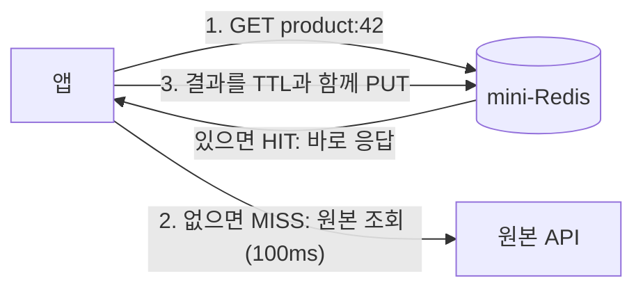

# Mini Redis

**느린 원본 API 앞에 두는 캐시 서버**입니다. 해시 테이블을 직접 구현한 키-값 저장소를 HTTP API로 열어, 어떤 앱이든 `curl` 한 줄로 값을 저장·조회·삭제할 수 있게 만들었습니다.

> 원본 API가 100ms 걸리는 상품 조회를, 캐시에 적중하면 응답 시간 중앙값 **0.4ms**로 처리합니다. (측정 조건은 [아래](#2-그래서-얼마나-빨라지나요))

---

## 1. 필요성

같은 상품 정보를 수천 번 조회하는데 원본 서버(DB·외부 API)가 매번 100ms씩 걸린다면, 사용자는 매번 기다리고 원본 서버는 같은 일을 반복합니다.

mini-Redis는 **한 번 가져온 응답을 메모리에 잠깐(TTL) 보관**했다가 다음 요청에 바로 돌려줍니다. 이것이 Cache-Aside 패턴입니다.



원본 데이터가 바뀌면 앱이 `DELETE`로 캐시를 지워(무효화) 다음 조회 때 새 값을 가져오게 합니다.

## 2. 성능 측정

원본 지연 100ms, 동시 사용자 20명, 30초씩 3회 반복한 측정입니다(`cmd/cachebench`).

| 캐시 | 응답 시간 p50 | p95 | 처리량 | 원본 호출 수(30초) | 실패 |
|---|---|---|---|---|---|
| 사용 안 함 | 100.93 ms | 101.97 ms | 198 req/s | 5,940 | 0 |
| **사용 (웜 캐시)** | **0.41 ms** | **1.73 ms** | **약 33,000 req/s** | **0** | 0 |

AOF 비활성, 상품 100개를 미리 채운 캐시, 적중률 100% 조건입니다. 측정 도구가 캐싱 흐름을 직접 수행했으며 소비 앱의 HTTP 구간은 포함하지 않았습니다.

- 캐시를 쓰면 원본을 **한 번도 호출하지 않았고**, 응답은 mini-Redis와의 HTTP 왕복 1회 시간만 남았습니다.
- 이 조건에서 **처리량은 약 167배**(198 → 32,987 req/s) 증가했고, **응답 시간 중앙값은 약 101ms에서 0.4ms로**(약 1/248) 줄었습니다. 캐시 적중으로 원본의 100ms 대기를 생략한 효과이므로, 원본이 빠를수록 차이는 작아집니다.
- Linux 4코어 컨테이너의 루프백에서 적중률 100%로 측정한 최선의 경우입니다. 자세한 조건과 원자료는 [측정 결과](docs/results/prd-t4.md)에 있습니다.

## 3. 원리

```text
HTTP 요청 ─▶ httpapi ─▶ store ─▶ hashtable
            경로·JSON·    검증·TTL·잠금·    키 → 값 보관
            오류 코드     AOF 기록 순서     (직접 구현)
```

계층마다 한 가지 일만 합니다. 해시 테이블은 TTL이나 HTTP를 모르고 키와 값만 보관합니다.

**구현 순서:** 해시 테이블의 저장·조회·삭제부터 만들어 검증하고, Store에 만료와 동시성 제어를 붙였습니다. 이후 HTTP API와 AOF를 연결하고, 원본 API·소비 앱을 통한 기능·성능 검증으로 확장했습니다.

### 과제 중점 포인트별: 무엇을, 왜

| 포인트 | 우리가 만든 것 | 왜 이렇게 했나 |
|---|---|---|
| **해시 테이블** | 키를 해시값으로 바꿔 저장할 버킷을 고르고, 같은 버킷에 들어온 키는 연결 리스트에서 원래 키를 비교해 구분(체이닝). 해시는 FNV-1a 64비트, 16버킷에서 시작해 적재율 0.75를 넘으면 2배로 재배치 | FNV-1a는 XOR과 곱셈 두 연산이라 원리를 한 줄씩 설명할 수 있고, 체이닝은 삭제가 단순합니다. 평균 O(1) |
| **동시성** | 저장소 전체를 Mutex 하나로 보호. 쓰기는 별도 순서 게이트로 AOF 기록 순서까지 맞춤 | 조회도 만료된 키를 지우는 "쓰기"라서 읽기 락으로 나누면 복잡해집니다. 락 하나가 "값이 반쯤 바뀐 상태"를 가장 확실히 막습니다 |
| **만료(TTL)** | 조회할 때 만료면 404와 함께 삭제(지연 삭제) + 약 100ms마다 백그라운드 정리 | 지연 삭제로 만료 키를 절대 돌려주지 않고, 아무도 조회하지 않는 만료 키의 메모리는 주기 정리로 회수합니다 |
| **API 구조** | `PUT / GET / DELETE /keys/{key}` + JSON, 오류는 `error.code`로 구분 | 언어·라이브러리 없이 `curl`만으로 쓸 수 있는 가장 익숙한 형태입니다 |
| **무효화** | 키 단위 `DELETE`가 기본, TTL은 보완 | 원본이 바뀐 순간 정확히 지울 수 있습니다. TTL은 오래된 캐시 값의 유효 기간을 제한하고, 만료 후 다음 조회에서 앱이 원본을 다시 읽어 캐시를 채웁니다 |
| **영속성 (선택)** | AOF: 변경을 파일에 기록 → 메모리 반영 → 응답. 기본 약 1초 주기로 디스크에 동기화하고, 재시작 시 기록을 재생해 복구 | 스냅샷은 마지막 저장 이후를 모두 잃지만, AOF는 변경마다 기록해 손실 구간을 짧게 가져갈 수 있습니다. 다만 마지막 동기화 이후의 변경은 잃을 수 있고, 1초는 목표 주기이지 손실 상한이 아닙니다. 커진 파일은 유효 키만 다시 쓰는 재작성으로 줄입니다 |
| **성능 비교** | 캐시 사용·미사용을 같은 조건에서 비교하는 측정 도구 `cmd/cachebench` | Postman 단건 시간이 아니라 동시 부하·반복 측정으로 비교해야 공정합니다 |

### 해시 테이블 주요 함수

| 함수 | 동작 |
|---|---|
| `Put(key, value)` | 키를 해시해 `해시 % 버킷 수`로 버킷을 찾고, 체인에 같은 키가 있으면 값 교체, 없으면 추가. 적재율 0.75 초과 시 2배 확장 |
| `Get(key)` | 같은 버킷의 체인을 따라가며 해시값과 원래 키가 모두 같은 노드를 찾음 |
| `Delete(key)` | 체인에서 해당 노드를 떼어 냄. 충돌 체인의 처음·중간·끝 어디서든 다른 키는 보존 |

## 4. 검증 방법

```bash
# 전체 테스트 + 데이터 레이스 탐지 (HTTP 동시성 검사는 작업자 50개 × 작업자당 100회)
go test -race -count=1 ./...

# 확장 동시성 검사: 작업자 50개 × 1,000회
MINI_REDIS_T3_FULL=1 go test -race ./internal/httpapi -run T3 -count=1 -v
```

| 검증 | 내용 |
|---|---|
| 단위 테스트 | 저장·조회·삭제, 해시 충돌 키, 확장 전후 보존, TTL 만료 직전·정각·이후, 잘못된 입력 |
| 기능 테스트 | 원본 API와 소비 앱(`cmd/demo`)을 띄워 MISS→HIT, 무효화, 원본 장애 시 미캐싱 등 확인 |
| 동시성 테스트 | 실제 HTTP 서버에 작업자 50개가 동시에 같은 키·다른 키를 저장·삭제·조회. 확장 검사(작업자당 1,000회)에서 반쯤 쓰인 값 등 예상 밖 응답 0건 |
| 영속성 테스트 | 재시작 후 값·삭제·남은 TTL 복원, 디스크 쓰기 실패 주입, 잘린 파일 복구, 손상 파일 감지 |

케이스별 테스트 이름은 [검증 대응표](docs/verification.md)에 있습니다.

## 5. 직접 보기 (데모)

```bash
MINI_REDIS_AOF=false go run ./cmd/miniredis   # 터미널 1: mini-Redis (8080)
go run ./cmd/demo                             # 터미널 2: 원본 API(8081, 100ms 지연) + 소비 앱(8082)

curl -si 'http://127.0.0.1:8082/demo/products/42' | grep -i x-cache   # X-Cache: MISS (약 100ms)
curl -si 'http://127.0.0.1:8082/demo/products/42' | grep -i x-cache   # X-Cache: HIT  (약 1ms)
```

---

## 실행 방법

Go 1.22 이상이 필요합니다. AOF는 Linux·macOS 로컬 파일 시스템에서 지원하며, Windows는 `MINI_REDIS_AOF=false`(메모리 모드)로 실행합니다.

```bash
git clone https://github.com/AI-Together-W10-W11-T1/Mini_Redis.git
cd Mini_Redis
go run ./cmd/miniredis          # 기본 127.0.0.1:8080, AOF는 data/appendonly.aof
```

```bash
curl -sS -X PUT 'http://127.0.0.1:8080/keys/user%3A101' \
  -H 'Content-Type: application/json' -d '{"value":"Minji","ttl_ms":30000}'
# {"ok":true}
curl -sS 'http://127.0.0.1:8080/keys/user%3A101'
# {"key":"user:101","value":"Minji","ttl_ms":29998}
curl -sS -X DELETE 'http://127.0.0.1:8080/keys/user%3A101'
# {"deleted":1}
```

### API 요약

| 요청 | 의미 |
|---|---|
| `PUT /keys/{key}` | `{"value":"문자열","ttl_ms":30000}` 저장. TTL 생략 시 무기한. 덮어쓰면 값과 TTL 모두 교체 |
| `GET /keys/{key}` | 값과 남은 TTL(밀리초) 반환. 무기한은 -1, 없거나 만료면 404 |
| `DELETE /keys/{key}` | `{"deleted":1}` 또는 `{"deleted":0}` |
| `GET /health` | 정상 200, 영속성 장애 시 503 |

키는 1~256바이트, 값은 최대 64 KiB 문자열입니다. 키에 `/`가 있으면 `%2F`로 인코딩합니다. 오류 코드와 상세 규칙은 [API 문서](docs/api.md)에 있습니다.

<details>
<summary>환경변수 설정</summary>

| 환경변수 | 기본값 | 의미 |
|---|---|---|
| `MINI_REDIS_ADDR` | `127.0.0.1:8080` | 대기 주소 `host:port` |
| `MINI_REDIS_AUTH_TOKEN` | 없음 | 지정 시 키 API에 Bearer 인증. 최소 16바이트 |
| `MINI_REDIS_ALLOW_UNAUTHENTICATED` | `false` | 비루프백 주소의 무인증 실행을 명시적으로 허용 |
| `MINI_REDIS_MAX_DATA_BYTES` | `268435456` | 데이터 근사 상한: 키+값+항목당 64바이트 (프로세스 메모리 상한 아님) |
| `MINI_REDIS_MAX_BODY_BYTES` | `524288` | HTTP 요청 본문 상한 |
| `MINI_REDIS_AOF` | `true` | `false`는 기존 파일도 읽지 않는 메모리 모드 |
| `MINI_REDIS_AOF_PATH` | `data/appendonly.aof` | 실행 디렉터리 기준 파일 경로 |
| `MINI_REDIS_AOF_MAX_BYTES` | 데이터 상한의 2배 (`536870912`) | AOF 파일+삭제 예약량 상한. 최소 `268435456` |
| `MINI_REDIS_AOF_REWRITE_MIN_BYTES` | `4194304` | 최소 재작성 증가량 기준. AOF 상한보다 작아야 함 |
| `MINI_REDIS_AOF_SYNC_INTERVAL_MS` | `1000` | 디스크 Sync 주기(10~60000). 길수록 장애 시 잃을 수 있는 구간이 늘어남 |
| `MINI_REDIS_DEBUG` | `false` | 디버그 로그(키 이름이 기록되므로 운영에서는 끄기). `-debug` 플래그 우선 |

</details>

## 한계

- 단일 인스턴스입니다. 복제·클러스터·LRU 축출·내장 TLS는 없습니다. 외부 공개 시 Bearer 토큰과 TLS 리버스 프록시를 함께 쓰세요.
- 같은 키의 동시 미적중을 하나로 합치지 않아 원본 호출이 겹칠 수 있습니다.
- 성공 응답은 디스크 Sync 완료를 뜻하지 않으며, 장애 시 마지막 Sync 이후 변경을 잃을 수 있습니다.

## 문서

- [설계 선택과 이유](docs/design-decisions.md) · [구조·동시성·만료](docs/architecture.md) · [API·오류 코드](docs/api.md)
- [AOF 영속성·복구](docs/persistence.md) · [Docker·systemd 배포](docs/deployment.md)
- [캐싱 데모](docs/demo.md) · [캐시 연동 방법](docs/cache-aside.md) · [성능 측정 방법](docs/benchmark.md) · [측정 결과](docs/results/prd-t4.md)
- [검증 대응표](docs/verification.md) · [과제 PRD와 단계별 학습 기록](docs/learning/README.md)

```bash
go test -race -count=1 ./... && go vet ./... && gofmt -l .
```

[MIT 라이선스](LICENSE)
